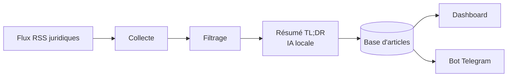

# DPO News

**Veille juridique automatisée pour les DPO : un dashboard et des notifications Telegram**

-1E3A5F?style=flat-square)

[Présentation](#présentation) ·
[Fonctionnement](#fonctionnement) ·
[Dashboard](#dashboard) ·
[Notifications Telegram](#notifications-telegram) ·
[Feuille de route](#feuille-de-route)

---

## Présentation

**DPO News** rassemble en un seul endroit l'actualité utile aux délégués à la protection des données : RGPD, décisions de la CNIL et du CEPD, cybersécurité, régulation de l'IA (AI Act).

L'outil :

- **collecte** les articles depuis des flux RSS de sources juridiques ;
- **filtre** les actualités importantes ;
- **résume** chaque article en une brève de 2 à 4 phrases (*TL;DR*), grâce à une IA locale ;
- **diffuse** les brèves sur un **dashboard** et par **notification Telegram**.

---

## Fonctionnement

| Étape | Rôle |
|---|---|
| Collecte | Lecture des flux RSS par rubrique (titre, lien, chapô, date) |
| Filtrage | Suppression des doublons, sélection des sujets pertinents |
| Résumé | Brève en style *flash news*, rédigée **uniquement** à partir du texte de l'article : aucune décision, date ou référence inventée |
| Diffusion | Publication sur le dashboard et envoi d'une notification Telegram |

Les résumés sont générés par un **modèle de langage local** (Ollama) : aucun article n'est envoyé à une API externe.

---

## Dashboard

Une interface web pour consulter la veille :

- fil des dernières brèves, avec la source et le lien vers l'article complet ;
- filtres par thème (RGPD, sanctions, cybersécurité, IA) et par date ;
- recherche par mot-clé.

---

## Notifications Telegram

Le bot envoie chaque nouvelle brève sur un canal Telegram :

> **📰 Titre de l'article**
> Résumé en 2 à 4 phrases.
> 🔗 Lien vers la source

---

## Feuille de route

- [x] Collecte des articles depuis les flux RSS
- [x] Résumé des articles par une IA locale
- [ ] Filtrage des actualités importantes et suppression des doublons
- [ ] Stockage des articles et des résumés
- [ ] Envoi des brèves sur Telegram
- [ ] Dashboard : fil d'actualité, filtres et recherche
- [ ] Exécution planifiée (collecte automatique à intervalle régulier)

---

## Avertissement

Les résumés sont générés automatiquement et peuvent contenir des imprécisions. Ils ne constituent **pas un conseil juridique** : reportez-vous toujours à l'article source.
