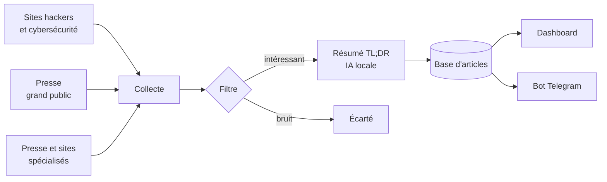

<picture>
  <source media="(prefers-color-scheme: dark)" srcset="assets/logo-dark.png">
  
</picture>

**Le dashboard de veille des DPO : toute l'actualité, seulement ce qui compte**

-1E3A5F?style=flat-square)

[Présentation](#présentation) ·
[Sources](#sources) ·
[Filtrage](#filtrage) ·
[Dashboard](#dashboard) ·
[Feuille de route](#feuille-de-route)

---

## Présentation

Un DPO doit suivre des dizaines de sources : sites spécialisés en cybersécurité, presse généraliste, médias juridiques, autorités de contrôle. La plupart des articles ne le concernent pas, et les quelques actualités importantes se perdent dans le bruit.

**DPO News** est un **dashboard de news** qui se connecte à toutes ces sources, applique un **filtre** et ne fait ressortir **que les actualités intéressantes** pour un DPO : fuites de données, sanctions, nouvelles règles, décisions de justice, régulation de l'IA.

---

## Fonctionnement

| Étape | Rôle |
|---|---|
| Collecte | Lecture des flux RSS de chaque source (titre, lien, chapô, date) |
| Filtrage | Suppression des doublons et sélection des seules actualités pertinentes pour un DPO |
| Résumé | Brève de 2 à 4 phrases en style *flash news*, rédigée **uniquement** à partir du texte de l'article : aucune décision, date ou référence inventée |
| Diffusion | Affichage sur le dashboard et, en option, notification Telegram |

Les résumés sont générés par un **modèle de langage local** (Ollama) : aucun article n'est envoyé à une API externe.

---

## Sources

DPO News croise trois familles de sources, pour ne rien rater et recouper l'information :

| Famille | Ce qu'elle apporte |
|---|---|
| **Sites hackers et cybersécurité** | Fuites de données, cyberattaques, failles, rançongiciels : souvent les premiers à sortir l'information |
| **Presse grand public** | Les affaires qui font l'actualité et leur retentissement auprès du public |
| **Presse et sites spécialisés** | Analyse juridique, textes officiels, décisions des autorités (CNIL, CEPD) et des juridictions |

---

## Filtrage

C'est le cœur de l'outil : sur l'ensemble des articles collectés, seule une petite partie arrive sur le dashboard.

Le filtre :

- **supprime les doublons**, quand plusieurs sources traitent du même sujet ;
- **écarte le bruit** : articles sans lien avec la protection des données, contenus promotionnels, actualités trop générales ;
- **garde les actualités utiles à un DPO** : RGPD et données personnelles, sanctions et décisions, fuites et incidents de sécurité, régulation de l'IA (AI Act).

---

## Dashboard

L'interface web où consulter la veille filtrée :

- fil des actualités retenues, chacune avec son résumé, sa source et le lien vers l'article complet ;
- filtres par thème (RGPD, sanctions, cybersécurité, IA), par type de source et par date ;
- recherche par mot-clé.

---

## Notifications Telegram

En complément du dashboard, le bot peut envoyer chaque actualité retenue sur un canal Telegram :

> **📰 Titre de l'article**
> Résumé en 2 à 4 phrases.
> 🔗 Lien vers la source

L'avatar du bot est fourni dans [`assets/avatar.png`](assets/avatar.png) (512 × 512 px).

---

## Feuille de route

- [x] Collecte des articles depuis les flux RSS
- [x] Résumé des articles par une IA locale
- [ ] Connexion des trois familles de sources (cybersécurité, grand public, spécialisées)
- [ ] Filtre : suppression des doublons et sélection des actualités intéressantes
- [ ] Stockage des articles et des résumés
- [ ] Dashboard : fil d'actualité, filtres et recherche
- [ ] Notifications Telegram
- [ ] Exécution planifiée (collecte automatique à intervalle régulier)

---

## Identité visuelle

| Fichier | Usage |
|---|---|
| [`assets/logo.png`](assets/logo.png) | Logo complet sur fond transparent (README, en-tête du dashboard) |
| [`assets/logo-dark.png`](assets/logo-dark.png) | Variante à texte clair pour les fonds sombres |
| [`assets/icon.png`](assets/icon.png) | Symbole seul, 512 × 512 px (icône du dashboard) |
| [`assets/favicon.svg`](assets/favicon.svg) | Symbole simplifié (3 relais, traits épais) sur fond blanc arrondi, pour l'onglet du navigateur |
| [`assets/favicon.ico`](assets/favicon.ico), [`favicon-32.png`](assets/favicon-32.png), [`apple-touch-icon.png`](assets/apple-touch-icon.png) | Exports du favicon (16/32/48 px, 32 px, 180 px) |
| [`assets/avatar.png`](assets/avatar.png) | Photo de profil du bot et du canal Telegram |

Le symbole représente un réseau de diffusion : l'actualité part d'une source centrale et rayonne vers ses lecteurs.

---

## Avertissement

Les résumés sont générés automatiquement et peuvent contenir des imprécisions. Ils ne constituent **pas un conseil juridique** : reportez-vous toujours à l'article source.
